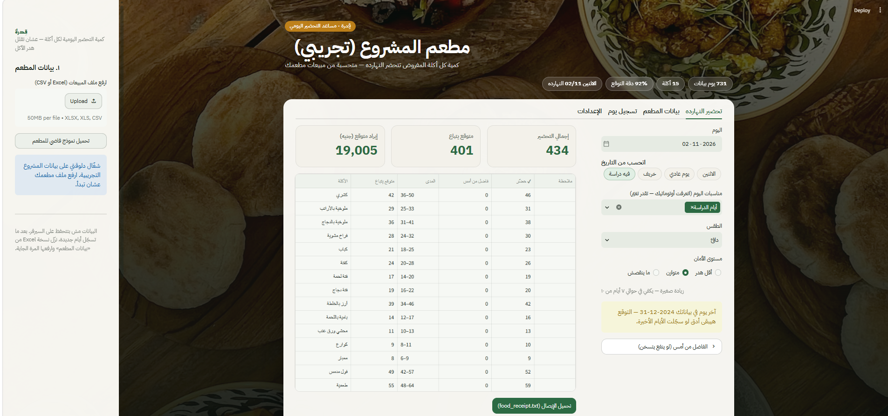
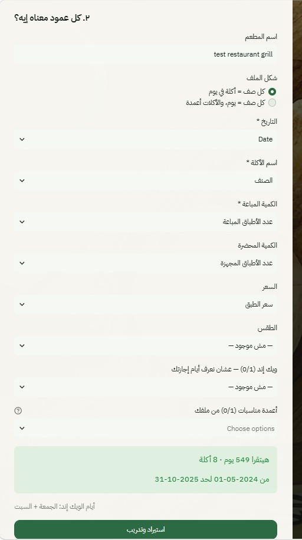
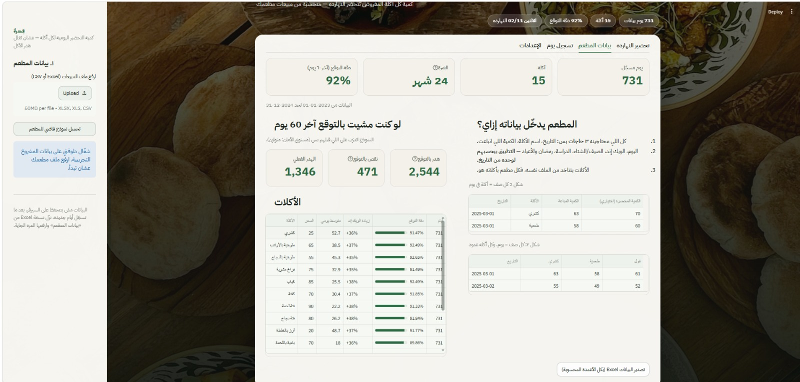

# 🍲 قِدرة | Qidra — Restaurant Food-Prep Predictor

**بيتوقّع كمية كل أكلة المطعم المفروض يحضّرها النهارده، عشان يقلل هدر الأكل.**
صاحب المطعم يرفع ملف مبيعاته (سنة، سنتين، أي مدة)، والتطبيق يتعلّم منه ويطلع له ورقة تحضير لكل يوم.

> **Predicts how many portions of each dish a restaurant should prepare today — to cut food waste.**
> Any restaurant uploads its own sales history; the app learns that restaurant's menu and patterns and produces a daily prep sheet.

<!-- بعد النشر على Streamlit Cloud حط اللينك هنا -->
**🔗 Live app:** _coming soon_


<sub>ورقة تحضير النهارده: كمية كل أكلة، والمدى المتوقع، والفاضل من امبارح · Today's prep sheet</sub>

---

## المشكلة | The problem
المطاعم بتحضّر بالإحساس: لو حضّرت زيادة الأكل بيترمي، ولو حضّرت ناقص بتخسر زباين.
الطلب بيتغير حسب اليوم (ويك إند ولا لأ)، والفصل، والدراسة، ورمضان والأعياد. وكل مطعم ليه منيو مختلف.

Restaurants prepare food by gut feeling. Demand shifts with the weekday, season, school term, Ramadan and holidays — and every restaurant has a different menu.

## الفكرة | How it works
1. **المطعم يدخّل ٣ أعمدة بس:** التاريخ، الأكلة، الكمية المباعة (والكمية المحضرة والسعر والطقس اختياري).
2. **التطبيق بيحسب الباقي من التاريخ:** اسم اليوم، ويك إند، الفصل، أيام الدراسة، رمضان، عيد الفطر، عيد الأضحى، شم النسيم، والإجازات الرسمية (تقويم مصري مدمج).
3. **موديل لكل أكلة** بيتدرّب على بيانات المطعم ده بالذات.
4. **ورقة تحضير لليوم:** متوقع يتباع كام، والمدى المتوقع، ويخصم الفاضل من امبارح، ويطلع `food_receipt.txt`.

| Input the owner gives | Computed automatically from the date |
|---|---|
| date · dish · quantity sold *(+ optional prepared, price, weather, custom 0/1 event columns)* | weekday · weekend (per restaurant) · season · school term · Ramadan · Eid al-Fitr · Eid al-Adha · Sham El-Nessim · official holidays |

### شكل ملف المطعم | Data format
الطريقتين شغالين، والتطبيق بيخمّن كل عمود معناه إيه، وصاحب المطعم يقدر يصحّح التخمين:

**Long** — one row per dish per day

| التاريخ | الأكلة | الكمية المباعة | الكمية المحضرة *(اختياري)* |
|---|---|---|---|
| 2025-03-01 | كشري | 63 | 70 |
| 2025-03-01 | طعمية | 58 | 60 |

**Wide** — one row per day, one column per dish

| التاريخ | كشري | طعمية | فول |
|---|---|---|---|
| 2025-03-01 | 63 | 58 | 61 |

**مطعم تاني بأسماء أعمدة مختلفة؟** التطبيق بيفهمها لوحده. ملف مطعم مشويات فيه `Date` و`الصنف` و`عدد الأطباق المباعة` و`عدد الأطباق المجهزة` و`سعر الطبق`، والتطبيق ربط كل عمود بمعناه وقرا 549 يوم و8 أكلات.
*A different restaurant with different column names, mapped automatically.*

<p align="center"></p>

There's a blank template at [`data/template.xlsx`](data/template.xlsx). Dates like `2025-03-01`, `01/03/2025` and Arabic digits (`٠١/٠٣/٢٠٢٥`) all work.

## الموديل والنتايج | Model & results
- **One Ridge regression per dish on `log(1 + sold)`.** Restaurant effects are multiplicative (a weekend lifts every dish by ~35%), and the log turns them into additive ones.
- Features: weekday, weekend, month, events, weather, trend.
- **Safety level:** the prep amount is `exp(μ + z·σ)` with z = 0 / 0.5 / 1 (*أقل هدر / متوازن / ما ينقصش*). Owners choose how they trade waste against running out.
- New dishes with no history: the owner's estimated daily average × today's restaurant-wide demand factor.

On the sample dataset (2 years, 15 dishes, 10,965 rows), trained on everything except the last 60 days and tested on those days:

| Model | MAE (portions) |
|---|---|
| Overall mean (baseline) | 6.3 |
| HistGradientBoosting | 4.9 |
| **Ridge on log(sales), per dish** | **2.9** |

**Accuracy on the last 60 days ≈ 92%.**


<sub>صفحة بيانات المطعم: دقة التوقع، ومقارنة آخر 60 يوم، وإحصائيات كل أكلة · Accuracy and per-dish stats</sub>

## التشغيل | Run it

```bash
git clone <this-repo-url>
cd <repo-folder>
pip install -r requirements.txt
python -m streamlit run app.py
```

**From the command line** (writes `food_receipt.txt`):
```bash
python predict.py data/sample_restaurant.xlsx --date 2026-11-06 --safety balanced
```

**In a notebook:**
```python
from qidra import load_file, DemandModel
r, report = load_file("my_restaurant.xlsx")
model = DemandModel(r).fit()
model.predict(date.today())
```

**Tests:** `pip install pytest && pytest -q`

## هيكل المشروع | Project structure
```
app.py              Streamlit app (upload → map columns → train → today's prep sheet)
predict.py          command-line prediction → food_receipt.txt
qidra/
  calendar_eg.py    Egyptian calendar: Ramadan, Eids, Sham El-Nessim, holidays, school term
  data_io.py        reads any restaurant's file (long or wide), guesses the columns
  restaurant.py     a restaurant's menu, history, settings, logging new days, Excel export
  model.py          per-dish ridge model, backtest, prediction, receipt
data/               sample dataset (2 years, 15 dishes), grill restaurant sample, wide-format sample, blank template
docs/index.html     standalone web version (runs fully in the browser, GitHub Pages)
tests/              pytest tests
```

## حدود المشروع | Limitations
- The sample dataset is synthetic. Its "prepared" column is almost equal to sales, so its real waste is lower than any honest forecast could reach.
- Ramadan and Eid dates are approximate (±1 day, depending on moon sighting). Any event can be toggled by hand.
- The Streamlit app doesn't store data on the server. Owners download the updated Excel after logging new days. The web version saves in the browser.

---
Made by **Karim Reda** · [GitHub](https://github.com/karimreda1203-wq)
